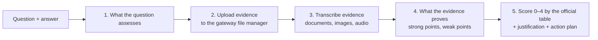

# Security Healthcheck Analysis API

Audits answers to an information-security controls questionnaire (ISF Security Healthcheck) against the evidence attached to each answer, and returns the scored spreadsheet with a justification and an action plan for every question.

**Stack:** Python · FastAPI · pandas · openpyxl · Server-Sent Events · AI gateway workflows (OAuth2) · pytest (132 tests)
**Role:** Lead developer: design and implementation

> Built at a large Brazilian insurer. The company is replaced by the fictional **Acme Seguros**, and every name, document and data point here is fictional. Code, prompts and UI are in Portuguese, written for Brazilian business teams.

## Problem

Every security control in the questionnaire is answered by its owner ("in most cases", "in all cases"...) and backed by evidence files: policies, screenshots, logs, spreadsheets. The security team had to open every file, decide whether it really proves the answer and assign a 0–4 score by hand, question by question.

## What I built

For each row of the questionnaire, a five-step agent:



- **Input:** the questionnaire as `.xlsx` and a `.zip` with one evidence folder per question; **output:** the same spreadsheet with ten analysis columns filled in.
- **Strict auditor persona** and the official answer-to-score table in the system prompt, so scores follow the framework, not the model's opinion.
- **Missing evidence handled explicitly:** when there is none, the agent evaluates the owner's justification instead.
- **Streaming endpoint (SSE)** sends progress logs in real time, with keep-alive comments so the platform proxy doesn't drop long analyses.
- **Evidence hygiene:** file type decided by extension, a 19 MB size cap, uploaded files deleted after transcription, temp folders always cleaned up.
- **132 tests** with every gateway call mocked.

## Run it

```bash
python -m venv .venv && .venv\Scripts\activate   # macOS/Linux: source .venv/bin/activate
pip install -r requirements.txt
pytest                                             # no keys needed
cp .env.example .env                               # gateway URL + Entra ID app
uvicorn src.main:app --reload                      # Swagger at /docs
```

---
Part of my [AI engineering portfolio](https://github.com/lucasboliveirasipp).
